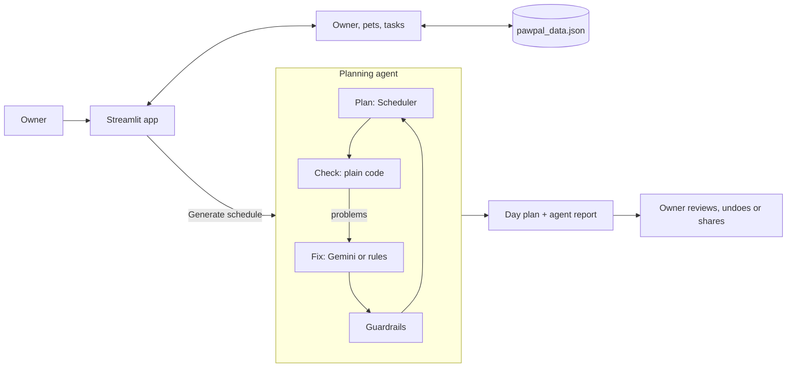

# 🐾 PawPal+ with a Planning Agent

## Original project

This project extends **PawPal+ (the Module 2 project)**, a Streamlit pet-care planner. The original
let an owner enter pets and care tasks (walks, feeding, medication, grooming), set a daily time
budget and priorities, and then produced a day plan with a reason for every placement. Its
scheduler picked the best set of tasks that fit the budget (a knapsack), placed them without
overlaps, warned about clashing requested times, and recreated daily and weekly tasks when they
were completed.

## Title and summary

**PawPal++** is a pet-care planner that checks and repairs its own schedule.

A busy owner asks for care at times that collide: two pets both need something at 8:00, or a
medication lands in the middle of a walk. The original scheduler resolved this by quietly shifting
tasks around. The new **planning agent** treats that first plan as a draft. It audits the plan,
proposes concrete fixes, applies only the fixes that pass safety guardrails, re-plans, and repeats
until the plan is clean. It then reports exactly what it changed, and the owner can undo it.

PawPal+ is a scheduling helper, not veterinary or medical advice: follow your vet's instructions for
medication.

It matters because a plan that silently reshuffles medication or feeding times is hard to trust.
Here every change is logged, bounded, explained and reversible, and problems the agent cannot
safely fix (such as two overlapping medications) are shown to the owner rather than hidden.

Other things the app does:

- Multiple pets, with **one shared task** for several pets (such as walking two dogs together).
- Add, **edit and delete** tasks; mark them done; repeating tasks reappear in an *Upcoming* list.
  Type a time to request one, or leave the time empty for a flexible task (the planner picks).
  Once a task is marked done it is read-only: it leaves the edit list and cannot be changed.
- **Saves everything** to a JSON file and reloads it on start.
- **Share the schedule** as plain text (copy button and `.txt` download) for family and friends.
- **Light and dark themes** with a switch in the app.
- **Activity and error log** you can view, trim and clear in the app (the **Log** tab), saved to a
  second JSON file, so you can see what the agent did and what failed and why.

## Architecture overview

The full diagram is in [diagrams/system_diagram.mmd](diagrams/system_diagram.mmd). In short:



**Data flows from input to output like this:**

1. **Input.** The owner enters pets, tasks and a time budget in the Streamlit app (`app.py`).
   Everything is held in the `Owner`, `Pet` and `Task` classes (`pawpal_system.py`) and saved to
   `pawpal_data.json` (`storage.py`) after every change.
2. **Process.** When the owner clicks *Generate schedule*, `PlannerAgent` (`agent.py`) runs a loop:
   - **Plan:** `Scheduler.generate_schedule()` picks tasks that fit the budget and places them.
   - **Check:** plain code looks for overlaps, tasks that could not be placed, clashing requested
     times, skipped high-priority tasks and medication over budget.
   - **Fix:** it proposes "move task X to HH:MM". Gemini makes the proposal if a key is set;
     otherwise (or if Gemini fails) built-in rules do.
   - **Guardrails:** every proposed move is validated before it is applied (see Design decisions).
   - The loop re-plans and re-checks, up to 5 passes, and rolls back if a pass made things worse.
3. **Output.** The day plan with reasons, an **agent report** (passes, changes, unresolved
   problems), a **share panel** with copyable text, and logs: a JSON activity log shown on the
   **Log** tab (`pawpal_log.json`) and a full text log (`pawpal_agent.log`).
4. **Human and test checks.** The owner reads the report and can accept it, click *Undo the agent's
   time changes*, or edit tasks and regenerate. The `pytest` suite checks the scheduler, agent,
   storage and sharing, and uses a fake LLM so the AI paths are tested offline.

## Setup instructions

Requires **Python 3.10 or newer**.

```bash
# 1. Get the code and open the project folder
cd applied-ai-system-project

# 2. Create and activate a virtual environment
python -m venv .venv
source .venv/bin/activate        # Windows PowerShell: .venv\Scripts\Activate.ps1

# 3. Install dependencies
pip install -r requirements.txt

# 4. Run the tests (no API key needed)
pytest

# 5. Start the web app (opens at http://localhost:8501)
streamlit run app.py

# 6. (Optional) Regenerate the execution evidence shown below, as text files in evidence/
python run_evidence.py
```

The terminal demo works too: `python main.py` (add `--no-agent` for the scheduler alone,
`--date YYYY-MM-DD` to pick a day).

**The agent works with no setup.** Out of the box it uses its built-in rules, so nothing below is
required to run or test the project.

**Optional: let Gemini propose the fixes**

1. Get a free key at [Google AI Studio](https://aistudio.google.com/apikey).
2. Copy `.env.example` to `.env` (same folder as `app.py`) and paste your key:
   ```
   GEMINI_API_KEY=paste-your-key-here
   ```
   `.env` is git-ignored. You can also `export GEMINI_API_KEY=...` instead; a real environment
   variable wins over the file.
3. Run `python main.py --llm`, or turn on **Gemini proposes the fixes** on the Schedule tab.

The model is `gemini-3.8-flash`; set `GEMINI_MODEL` in `.env` if your key uses a different ID.
Free-tier requests may be used by Google to improve its products, so don't put private details in
task names.

**Where things are saved:**
- `pawpal_data.json` next to `app.py` holds your pets and tasks (change the location with the
  `PAWPAL_DATA_FILE` variable). Reset it from *Pets > Saved data*, or delete the file.
- `pawpal_log.json` holds the activity and error log (`PAWPAL_LOG_FILE` changes the location).
  Open the **Log** tab to read it, remove single entries, clear it, or download it.
- `pawpal_agent.log` is a plain-text log with every detail.

## Logging and error handling

The app records what it did and what went wrong, and shows it on the **🧾 Log** tab.

- **What is recorded:** every warning and error from anywhere in the app (a failed save, a Gemini
  error, a rejected edit), plus the planning agent's own activity (each pass, each move it applied
  or rejected). Each entry has a time, level (`ERROR`, `WARNING`, `INFO`), source and message;
  errors from exceptions also keep the error and its technical details.
- **View, remove, clear:** filter by level, pick entries to remove, clear the whole log (behind a
  confirmation box), or download it as JSON.
- **Bounded and safe:** the log keeps the newest 500 entries, is written atomically, and a corrupt
  log file is moved aside rather than crashing the app. Logging itself can never raise an error.
- **Errors are handled, not just logged:**
  - A Gemini failure falls back to the rules and says so in the report.
  - A failed save shows a warning in the app and is retried when your data next changes (it is
    logged once, not on every refresh).
  - A corrupt data file is moved aside with a warning instead of being overwritten.
  - Unsafe agent moves are rejected and logged with the reason.
  - Bad input to an edit is refused and recorded.

The code is in `eventlog.py` (a handler that plugs into Python's `logging`).

## Sample interactions

All outputs below are real, produced by `python main.py --date 2026-10-20`, which builds an owner
with two pets (Buddy and Mia) and six tasks. Buddy's walk and Mia's breakfast are both requested at
08:00, and Mia's thyroid medication at 08:15.

### 1. The scheduler alone, versus the planning agent

**Input:** the six tasks above, `python main.py --no-agent`

```
08:00-08:30   Buddy   Morning walk      HIGH         30 min
08:30-08:40   Mia     Breakfast         HIGH         10 min
              ↳ due 08:00, shifted +30 min to 08:30 (slot taken)
08:40-08:45   Mia     Thyroid meds      HIGH          5 min
              ↳ due 08:15, shifted +25 min to 08:40 (slot taken)
...
⚠ Buddy: Morning walk (08:00) is at the same time as Mia: Breakfast (08:00) [different pets]
⚠ Buddy: Morning walk (08:00) overlaps Mia: Thyroid meds (08:15) [different pets]
```

The plan has no overlaps, but the warnings remain: the owner's requested times are still wrong,
and the plan silently moved the medication.

**Input:** the same tasks, `python main.py` (planning agent, rule-based)

```
Planning agent (fixes by: rules)
Pass 1: 2 issue(s) found
  ! Requested times clash: Buddy: Morning walk (08:00) and Mia: Breakfast (08:00)
  ! Requested times clash: Buddy: Morning walk (08:00) and Mia: Thyroid meds (08:15)
  -> move Mia: Breakfast 08:00 -> 08:30 (requested time clashed with Buddy: Morning walk)
  -> move Mia: Thyroid meds 08:15 -> 08:40 (requested time clashed with Buddy: Morning walk)
Pass 2: 0 issue(s) found
  Plan passed all checks.
Result: plan passed all checks
```

The agent updates the requested times to where the plan put them, re-checks, and the warnings are
gone. In the app each change is listed in the agent report with an **Undo** button.

### 2. With Gemini proposing the fixes

**Input:** the same tasks, `python main.py --llm` with a valid `GEMINI_API_KEY`.

When Gemini answers, it proposes its own repair and the agent applies it through the same
guardrails. This is the agent's log from a real run:

```
LLM proposed 1 move(s)
Applied [llm]: Buddy: Morning walk 08:00 -> 09:05 (Move morning walk to an open morning slot to resolve conflicts with breakfast and medication)
```

Gemini chose a different fix from the rules: it moved Buddy's walk (one move) instead of moving
Mia's breakfast and medication (two moves). Both pass the checks. Its answers vary from run to run.

**When Gemini is unavailable** (the free tier returned `429 quota` and `503 high demand` during
testing), the agent logs the error (visible on the Log tab), uses its rules, and says so in the
output:

```
Planning agent (fixes by: rules (Gemini was unavailable or its suggestions were unusable))
Pass 1: 2 issue(s) found
  ...
Result: plan passed all checks
```

### 3. A problem the agent refuses to "fix"

**Input:** two 60-minute medications for Mia, both requested at 08:00.

```
Rejected move for Mia: Thyroid pill B: shift of 60 min exceeds the 30 min limit
Planning agent (fixes by: rules)
Pass 1: 1 issue(s) found
  ! Requested times clash: Mia: Thyroid pill A (08:00) and Mia: Thyroid pill B (08:00)
  x rejected: Mia: Thyroid pill B: shift of 60 min exceeds the 30 min limit
  No safe fix available; stopping.
Result: 1 problem(s) remain
```

Medication may only move 30 minutes, so the agent stops and reports the unresolved clash instead of
pushing a pill an hour late. The owner sees it in the report and decides.

### 4. Sharing the schedule

**Input:** the repaired plan from example 1, via the **Share this schedule** panel (copy button).

```
🐾 Pet care schedule for Travis
Tuesday, October 20

8:00 AM - 8:30 AM  🐶 Buddy: Morning walk
8:30 AM - 8:40 AM  🐱 Mia: Breakfast
8:40 AM - 8:45 AM  🐱 Mia: Thyroid meds
8:45 AM - 9:05 AM  🐶 Buddy: Brush coat
12:00 PM - 12:25 PM  🐱 Mia: Playtime
6:00 PM - 6:10 PM  🐶 Buddy: Evening feeding

Total: 100 min of 120 available
```

Switches turn emojis off for plain texts, or the clock to 24-hour.

## Reproducible execution evidence

Everything in this section was produced by one command, so it can be checked without running
the app or watching a video:

```bash
python run_evidence.py        # no API key or network needed, takes about 10 seconds
```

It runs real commands (`python main.py ...`, `python -m pytest -q`) and scripted scenarios against the
real code, prints the report, and saves it as text files:
[evidence/evidence_report.txt](evidence/evidence_report.txt) and
[evidence/pytest_output.txt](evidence/pytest_output.txt). Two separate runs produce identical reports
apart from the test timing. The dates are fixed (October 20, 2026), and everything is saved to a
temporary folder, so your own data and logs are never touched.

**Honesty note:** the Gemini replies in Cases A and B and Guardrail 1 are *scripted stand-ins*, so the
results are repeatable. Live Gemini is non-deterministic and rate limited; a real excerpt from a live
run is in *Sample interactions*, example 2.

| What the grader asks for | Where to look |
|---|---|
| End-to-end system runs (3 inputs) | Part 1, Cases 1, 2 and 3 |
| AI feature behaviour (the planning agent) | Part 2, Cases A and B (plus Part 1, Case 1) |
| Reliability and guardrail behaviour | Part 3, Guardrails 1 to 4, and Part 4 (101 tests) |
| Clear outputs for each case | The `OUTPUT` and `RESULT` lines in each block below |

### Reliability and guardrail results at a glance

| Check | Input | Observed result |
|---|---|---|
| Unsafe model moves rejected | Medication +345 min, unknown task `T99`, time `25:99` | All three refused or ignored and logged; medication moved only 25 min (limit 30); plan passed all checks |
| Unfixable problem reported | Two 60-minute medications at the same time | Agent stopped with "No safe fix available"; `resolved = False`; 1 problem reported |
| Model failure handled | Gemini returns a 429 quota error | Fell back to rules; output says so; `WARNING` recorded in the activity log |
| Corrupt data file | `{ this is not valid json` | Moved aside to a `.corrupt-<timestamp>` backup, `StorageError` raised, nothing overwritten |
| Failed save | Unwritable location | Returned `False` without raising; `ERROR` recorded in the activity log |
| Finished task is read-only | Edit after marking done | `ValueError: a completed task can't be edited` |
| Overbooked day | 105 min of high-priority work in 60 min | Medication kept, one task skipped, advice shown |
| Automated tests | `python -m pytest -q` | **101 passed** |

### Part 1. End-to-end runs

#### Case 1: two pets, six tasks, clashing requested times (real CLI commands)

**Input:** the six tasks shown. **What it demonstrates:** an end-to-end run from the real command line. The scheduler alone leaves two clash warnings; the planning agent finds the same two clashes, fixes them, re-checks, and the warnings are gone.

```text
INPUT (built into main.py):
  Buddy        Evening feeding   10 min  HIGH   requested 18:00
  Buddy        Brush coat        20 min  LOW    flexible
  Buddy        Morning walk      30 min  HIGH   requested 08:00
  Mia          Playtime          25 min  MEDIUM requested 12:00
  Mia          Thyroid meds       5 min  HIGH   requested 08:15
  Mia          Breakfast         10 min  HIGH   requested 08:00

$ python main.py --no-agent --date 2026-10-20        # the scheduler on its own
Oct 20 Schedule · Travis · Tuesday, October 20
───────────────────────────────────────────────────────────
TIME          PET     TASK              PRIORITY   DURATION
───────────────────────────────────────────────────────────
08:00-08:30   Buddy   Morning walk      HIGH         30 min
08:30-08:40   Mia     Breakfast         HIGH         10 min
              ↳ due 08:00, shifted +30 min to 08:30 (slot taken)
08:40-08:45   Mia     Thyroid meds      HIGH          5 min
              ↳ due 08:15, shifted +25 min to 08:40 (slot taken)
08:45-09:05   Buddy   Brush coat        LOW          20 min
              ↳ flexible time
12:00-12:25   Mia     Playtime          MEDIUM       25 min
18:00-18:10   Buddy   Evening feeding   HIGH         10 min
───────────────────────────────────────────────────────────
Planned 100 of 120 min  [█████████████████░░░] 83%

⚠ Buddy: Morning walk (08:00) is at the same time as Mia: Breakfast (08:00) [different pets]
⚠ Buddy: Morning walk (08:00) overlaps Mia: Thyroid meds (08:15) [different pets]

$ python main.py --date 2026-10-20                   # with the planning agent
Oct 20 Schedule · Travis · Tuesday, October 20
───────────────────────────────────────────────────────────
TIME          PET     TASK              PRIORITY   DURATION
───────────────────────────────────────────────────────────
08:00-08:30   Buddy   Morning walk      HIGH         30 min
08:30-08:40   Mia     Breakfast         HIGH         10 min
08:40-08:45   Mia     Thyroid meds      HIGH          5 min
08:45-09:05   Buddy   Brush coat        LOW          20 min
              ↳ flexible time
12:00-12:25   Mia     Playtime          MEDIUM       25 min
18:00-18:10   Buddy   Evening feeding   HIGH         10 min
───────────────────────────────────────────────────────────
Planned 100 of 120 min  [█████████████████░░░] 83%

Planning agent (fixes by: rules)
Pass 1: 2 issue(s) found
  ! Requested times clash: Buddy: Morning walk (08:00) and Mia: Breakfast (08:00)
  ! Requested times clash: Buddy: Morning walk (08:00) and Mia: Thyroid meds (08:15)
  -> move Mia: Breakfast 08:00 -> 08:30 (requested time clashed with Buddy: Morning walk)
  -> move Mia: Thyroid meds 08:15 -> 08:40 (requested time clashed with Buddy: Morning walk)
Pass 2: 0 issue(s) found
  Plan passed all checks.
Result: plan passed all checks
```

#### Case 2: a task shared by two pets, saved, edited, finished (modules, temp files)

**Input:** a shared task, a flexible task, an edit, and an attempted edit of a finished task. **What it demonstrates:** an end-to-end run through storage (saved and reloaded as one shared task), editing, planning, the shareable text, and the read-only rule for finished tasks.

```text
INPUT: one 'Vet call' for Mochi AND Mia at 07:30 (30 min, HIGH), plus a flexible 'Brush coat'

OUTPUT 1: saved data file (pawpal_data.json), the shared task is ONE entry:
  {"title": "Vet call", "due": "2026-10-20T07:30:00", "shared_with": ["Mia"], "completed": false}
OUTPUT 2: reloaded from disk: 2 tasks, 'Vet call' is for Mochi & Mia
OUTPUT 3: edited in place: now 45 min at 09:00
OUTPUT 4: planned and shared as text:
  🐾 Pet care schedule for Travis
  Tuesday, October 20
  
  8:00 AM - 8:20 AM  🐶 Mochi: Brush coat
  9:00 AM - 9:45 AM  🐶🐱 Mochi & Mia: Vet call
  
  Total: 65 min of 120 available
OUTPUT 5: editing the finished task is refused -> ValueError: a completed task can't be edited
OUTPUT 6: 'Clear completed' removed 1 task; left: ['Brush coat']
```

#### Case 3: an overbooked day (60 minutes available, 105 minutes of HIGH priority work)

**Input:** 105 minutes of high-priority work in a 60-minute day. **What it demonstrates:** the planner keeps the mandatory medication, fits what it can, and reports the skipped high-priority task with advice instead of hiding it.

```text
INPUT:
  Rex          Long hike         50 min  HIGH   flexible
  Rex          Swim              50 min  HIGH   flexible
  Rex          Eye drops          5 min  HIGH   flexible
OUTPUT:
Oct 20 Schedule · Travis · Tuesday, October 20
───────────────────────────────────────────────────
TIME          PET   TASK        PRIORITY   DURATION
───────────────────────────────────────────────────
08:00-08:05   Rex   Eye drops   HIGH          5 min
              ↳ flexible time
08:05-08:55   Rex   Long hike   HIGH         50 min
              ↳ flexible time
───────────────────────────────────────────────────
Skipped (no time left)
  • Rex: Swim (50 min)
───────────────────────────────────────────────────
Planned 55 of 60 min  [██████████████████░░] 92%
Planning agent (fixes by: rules)
Pass 1: 1 issue(s) found
  ! High-priority task skipped for lack of time: Rex: Swim (50 min); roughly 45 more minutes in the daily budget would help
  Plan passed all checks.
Result: plan passed all checks
  advice: High-priority task skipped for lack of time: Rex: Swim (50 min); roughly 45 more minutes in the daily budget would help
```

### Part 2. AI feature behaviour (the planning agent)

#### Case A: Gemini proposes a fix and the agent applies it

**AI feature behaviour:** the model (scripted here) proposes a concrete move, the agent applies it through its guardrails, re-checks, and lets the rules finish what remains. The summary says exactly who did what.

```text
SCRIPTED Gemini reply: {"moves": [{"task_id": "T6", "new_time": "09:10", "reason": "Move breakfast after the walk"}]}
OUTPUT:
Planning agent (fixes by: Gemini, with the rules finishing the rest)
Pass 1: 2 issue(s) found
  ! Requested times clash: Buddy: Morning walk (08:00) and Mia: Breakfast (08:00)
  ! Requested times clash: Buddy: Morning walk (08:00) and Mia: Thyroid meds (08:15)
  -> move Mia: Breakfast 08:00 -> 09:10 (Move breakfast after the walk)
Pass 2: 1 issue(s) found
  ! Requested times clash: Buddy: Morning walk (08:00) and Mia: Thyroid meds (08:15)
  -> move Mia: Thyroid meds 08:15 -> 08:30 (requested time clashed with Buddy: Morning walk)
  x rejected: Mia: Breakfast: no change
Pass 3: 0 issue(s) found
  Plan passed all checks.
Result: plan passed all checks
(Pass 2: the scripted Gemini repeats its same move, which is now a no-op and is rejected, so the rules finish the remaining clash.)
```

#### Case B: Gemini fails (quota error), the agent falls back to its rules

**AI feature behaviour under failure:** the model call fails with a quota error, the agent falls back to its rules, says so in its output, and records the failure in the activity log.

```text
SCRIPTED Gemini failure: 429 RESOURCE_EXHAUSTED: You exceeded your current quota
OUTPUT:
Planning agent (fixes by: rules (Gemini was unavailable or its suggestions were unusable))
Pass 1: 2 issue(s) found
  ! Requested times clash: Buddy: Morning walk (08:00) and Mia: Breakfast (08:00)
  ! Requested times clash: Buddy: Morning walk (08:00) and Mia: Thyroid meds (08:15)
  -> move Mia: Breakfast 08:00 -> 08:30 (requested time clashed with Buddy: Morning walk)
  -> move Mia: Thyroid meds 08:15 -> 08:40 (requested time clashed with Buddy: Morning walk)
Pass 2: 0 issue(s) found
  Plan passed all checks.
Result: plan passed all checks
Recorded in the JSON activity log (what the app's Log tab shows):
  [WARNING] agent: LLM fixer failed (RuntimeError: 429 RESOURCE_EXHAUSTED: You exceeded your current quota); f...
```

### Part 3. Reliability and guardrail results

#### Guardrail 1: unsafe or invalid Gemini moves are rejected

**Guardrail:** three bad model moves (a medication 6 hours late, a task that does not exist, a time that is not a time) are rejected or ignored and logged; the medication stays within its 30-minute limit.

```text
SCRIPTED Gemini reply: {"moves": [{"task_id": "T5", "new_time": "14:00", "reason": "meds six hours late"}, {"task_id": "T99", "new_time": "09:00", "reason": "a task that does not exist"}, {"task_id": "T6", "new_time": "25:99", "reason": "not a real time"}]}
OUTPUT:
Planning agent (fixes by: rules (Gemini was unavailable or its suggestions were unusable))
Pass 1: 2 issue(s) found
  ! Requested times clash: Buddy: Morning walk (08:00) and Mia: Breakfast (08:00)
  ! Requested times clash: Buddy: Morning walk (08:00) and Mia: Thyroid meds (08:15)
  -> move Mia: Breakfast 08:00 -> 08:30 (requested time clashed with Buddy: Morning walk)
  -> move Mia: Thyroid meds 08:15 -> 08:40 (requested time clashed with Buddy: Morning walk)
  x rejected: Mia: Thyroid meds: shift of 345 min exceeds the 30 min limit
Pass 2: 0 issue(s) found
  Plan passed all checks.
Result: plan passed all checks
Invalid moves that never got that far (recorded in the activity log):
  [WARNING] agent: Ignoring malformed LLM move {'task_id': 'T99', 'new_time': '09:00', 'reason': 'a task that ...
  [WARNING] agent: Ignoring malformed LLM move {'task_id': 'T6', 'new_time': '25:99', 'reason': 'not a real ti...
  [WARNING] agent: Rejected move for Mia: Thyroid meds: shift of 345 min exceeds the 30 min limit
RESULT: Thyroid meds moved 25 min (limit 30), not 345; no unknown task was touched
```

#### Guardrail 2: a problem the agent cannot safely fix is reported, not forced

**Guardrail:** when no safe fix exists the agent stops and reports the problem instead of forcing one.

```text
OUTPUT:
Planning agent (fixes by: rules)
Pass 1: 1 issue(s) found
  ! Requested times clash: Mia: Thyroid pill A (08:00) and Mia: Thyroid pill B (08:00)
  x rejected: Mia: Thyroid pill B: shift of 60 min exceeds the 30 min limit
  No safe fix available; stopping.
Result: 1 problem(s) remain
RESULT: agent resolved the plan: False (expected False: it refuses to push a medication an hour late)
```

#### Guardrail 3: a corrupt data file is moved aside, never overwritten

**Guardrail:** a corrupt data file is kept as a backup and the app starts fresh with a warning, rather than overwriting it.

```text
OUTPUT: StorageError: Expecting property name enclosed in double quotes: line 1 column 3 (char 2) (the file was moved to corrupt_data.json.corrupt-<timestamp>)
RESULT: the corrupt file was kept as a backup, not overwritten: ['corrupt_data.json.corrupt-<timestamp>']
  [ERROR] storage: Could not load <tmp>/corrupt_data.json (Expecting property name enclosed in double quotes: ...
```

#### Guardrail 4: a failed save is logged (once) and reported, not hidden

**Guardrail:** a failed save does not raise; it returns False, is logged once, and the app shows a warning.

```text
OUTPUT: save_owner returned False (it did not raise)
  [ERROR] storage: Could not save <tmp>/a_file/data.json: [WinError 183] Cannot create a file when that file a...
```

### Part 4. Automated test suite

**Reliability evaluation:** the whole suite, including the agent (with a fake Gemini), storage, logging and the real app, passes.

```text
$ python -m pytest -q
101 passed in 4.35s
Tests per file: test_agent.py=18, test_app_times.py=8, test_devreload.py=2, test_eventlog.py=9, test_fileutil.py=5, test_pawpal_system.py=42, test_sharing.py=5, test_storage.py=12
```

## Design decisions

**The agent wraps the scheduler instead of replacing it.** The knapsack selection and gap
placement from the original project stay as the deterministic core; the agent only adds a
check-and-fix loop around it. *Trade-off:* the agent can only change requested times. It cannot
reorder priorities or change the budget, so some problems (a high-priority task with no time left)
can only be reported as advice.

**The checker is plain code; the LLM only proposes moves.** A language model never grades its own
work, and it cannot emit anything except "move task X to HH:MM". *Trade-off:* the agent only
notices the kinds of problems I wrote checks for.

**Rules first, Gemini optional.** The project runs, tests and demos with no API key, and a failing
or garbled LLM response falls back to the rules. *Trade-off:* on simple clashes the LLM adds little
over the rules; its value would show on messier plans, which I did not test at scale.

**The agent edits the user's requested times, with Undo.** That is what makes the agent change
the system's behaviour (the warnings actually go away). *Trade-off:* it modifies the user's data,
so every change is listed and reversible. Undo stays available until you generate again or change a task.

**Guardrail limits are judgment calls.** A move must stay on the same day, shift at most 4 hours
(30 minutes for medication), and a task can move at most twice, over at most 5 passes, with
rollback to the best plan seen. The numbers are reasonable but not validated against real users.

**A shared task is one task, not copies.** Choosing two pets makes a single task (it takes one
slot, is completed once, and shows for each pet), matching how people think about "walk both
dogs." *Trade-off:* the model change touched the scheduler, storage and UI, and the task is stored
under the first pet chosen.

**A JSON log you can see, not just a log file.** The log is a second JSON file, shown in the app,
so a non-programmer can see what failed and why, and trim it. *Trade-off:* only warnings, errors
and agent activity go in it (routine saves would drown the useful entries), and it is capped at 500
entries, so the plain-text log remains the complete record.

**JSON file for persistence.** One human-readable file, written atomically, with a corrupt file moved
aside rather than overwritten. *Trade-off:* it suits one user on one machine; there is no
concurrency control and the whole file is rewritten on every change.

**Custom styling on top of Streamlit.** Two themes and card layouts make the app easier to read.
*Trade-off:* the CSS depends on Streamlit's internal element names, so a Streamlit upgrade may
break parts of it. A small `devreload.py` keeps the running app current while editing code.

## Testing summary

**101 automated tests, all passing** (`pytest`):

| File | Tests | Covers |
|------|------:|--------|
| `test_pawpal_system.py` | 42 | Scheduler, sorting, filtering, conflicts, recurrence, shared tasks, edit and delete, completed tasks are read-only |
| `test_agent.py` | 18 | The loop, guardrails, rollback, Gemini parsing, fallbacks (using a fake LLM client) |
| `test_storage.py` | 12 | Save and load round trips, corrupt and invalid files, old file formats |
| `test_sharing.py` | 5 | The shareable text |
| `test_eventlog.py` | 9 | The JSON log: entries, tracebacks, size cap, delete and clear, corrupt file, never raising, agent failures recorded |
| `test_app_times.py` | 8 | Drives the real app: requested times are saved, finished tasks leave the edit list, a bad remembered choice does not crash, Medium is the default priority, the not-medical-advice notice shows |
| `test_fileutil.py` | 5 | Atomic writes, moving corrupt files aside, logging setup |
| `test_devreload.py` | 2 | Live reload of edited modules |

**What worked.**
- Testing the AI paths with a fake client: bad JSON, API errors and unsafe moves are all covered
  offline and repeatably.
- Driving the real app (Streamlit's test harness, and a real browser for layouts, the copy button
  and downloads) found problems that unit tests could not see.

**What didn't, and what I fixed.**
- Marking a repeating task with no requested time as done created its next copy immediately, so it
  looked like the button did nothing. Repeats now become available the next day.
- After code edits, an open browser tab kept old objects and crashed (`KeyError`,
  `AttributeError`). The app now detects this and reloads from the saved file.
- The "Reset all data" button changed a widget's own state, which Streamlit forbids; it now
  uses a callback.
- The first dark theme did not apply to Streamlit's selects and form buttons, because I guessed the
  element names. I checked screenshots and fixed the selectors.
- The output said **"LLM fixer"** even when Gemini had failed and the rules did the work. It now
  says which one actually made the changes.

**Known gaps.**
- Live Gemini answers are non-deterministic and the free tier is unreliable (`429` and `503` seen),
  so I only verified the Gemini path end to end a few times, and cannot promise a given result.
- Google's own model page did not list `gemini-3.8-flash`, but its API accepted the name: the
  free-tier quota error names that model and a limit of 20 requests per day, which explains the
  `429`s. The model name stays configurable.
- Not tested: phone-sized screens, other browsers, and what a future Streamlit version does to the
  custom styling.
- I could not render the Mermaid diagram here, so check it displays correctly.

**What I learned.** Unit tests proved the logic; running the actual app found most of the real
bugs. And an AI feature needs honest reporting: a fallback that works but is labelled wrongly is
still a bug.

## Reflection

Building this showed me that the useful part of an AI feature is often the part around the model.
The LLM's contribution is small, one proposed move. The value comes from the deterministic checker
that decides whether it worked, the guardrails that bound what it may do, the fallback for when it
fails, and the report and Undo that keep a person in charge. Designing those pieces first made the
model easy to swap and easy to test, and the project still works if it disappears entirely.

It also taught me to verify instead of trusting a green test run. Several of the worst bugs
(a button that appeared to do nothing, stale state after edits, a mislabeled fallback) only showed
up when I used the app the way a person would.

My responsible-AI reflection (how I worked with AI, a suggestion I accepted and one I rejected or
revised, and the system's limitations) is in **`model_card.md`**.

## Project structure

| Path | Purpose |
|------|---------|
| `app.py` | Streamlit app (Pets, Tasks, Schedule and Log tabs, agent report, share panel) |
| `pawpal_system.py` | `Owner`, `Pet`, `Task` and the `Scheduler` (selection, placement, conflicts) |
| `agent.py` | `PlannerAgent`: plan, check, fix and repeat; guardrails; Gemini and rule-based fixers |
| `storage.py` | Save and load the JSON data file safely |
| `sharing.py` | Turn a schedule into shareable text |
| `eventlog.py` | JSON activity and error log (feeds the Log tab) |
| `config.py` | Loads the `.env` file and sets up logging |
| `fileutil.py` | Shared safe file writing and corrupt-file handling |
| `theme.py` | Light and dark colour schemes |
| `run_evidence.py` | Regenerates the reproducible execution evidence (`python run_evidence.py`) |
| `evidence/` | The generated evidence logs: `evidence_report.txt` and `pytest_output.txt` |
| `devreload.py` | Reload edited modules without restarting Streamlit |
| `main.py` | Terminal demo |
| `tests/` | The pytest suite |
| `diagrams/system_diagram.mmd` | System architecture diagram |
| `.env.example` | Template for your Gemini key |
